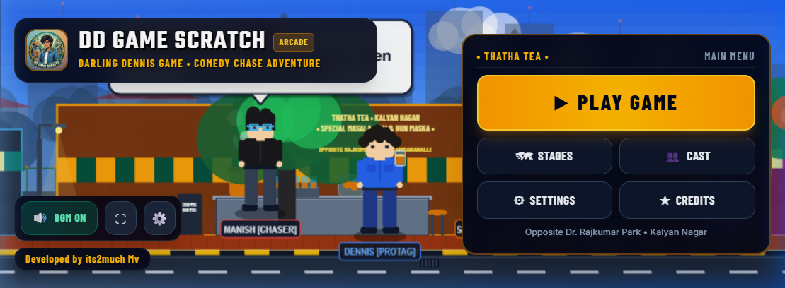
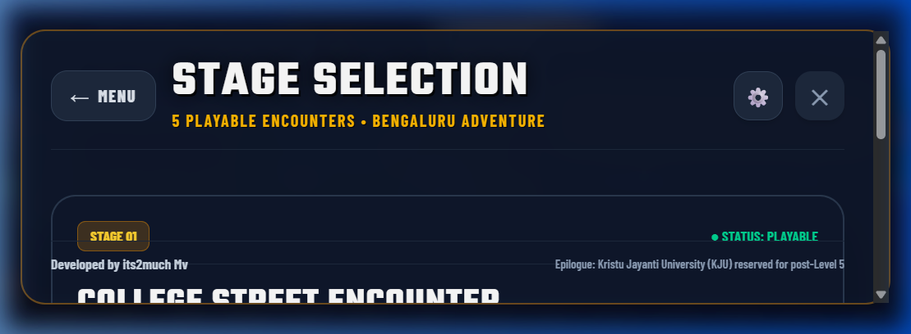
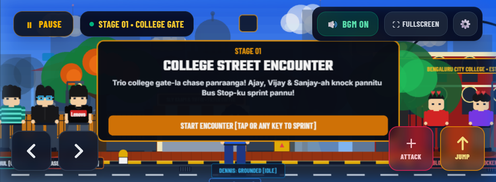
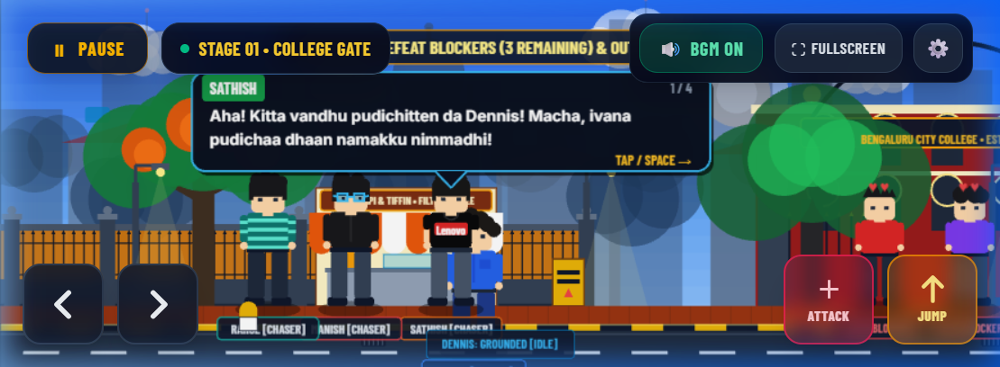
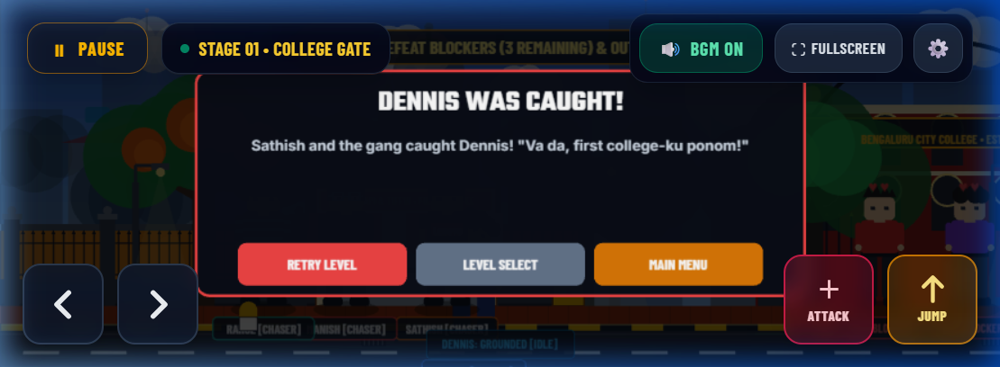
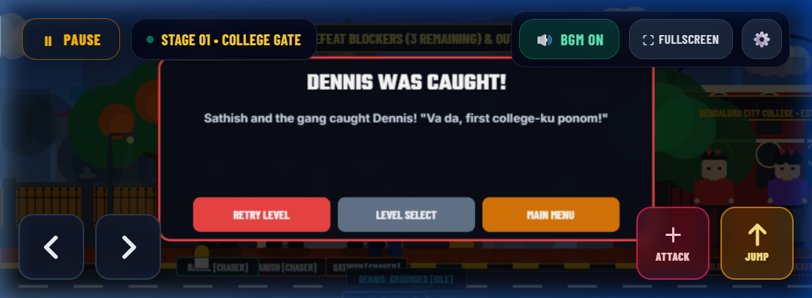
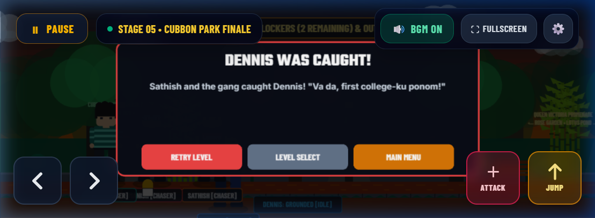
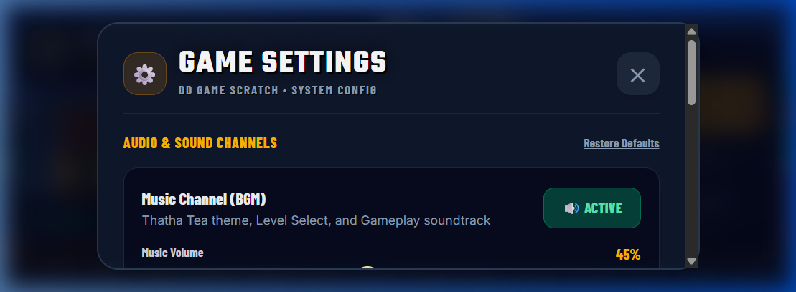

# DD Game Scratch — Darling Dennis Game

[](https://dd-game-scratch.vercel.app/)
[](https://github.com/manishvenki/dd-game-scratch)
[](https://phaser.io/)
[](https://www.typescriptlang.org/)
[](https://vitest.dev/)

**DD Game Scratch — Darling Dennis Game** is an arcade-style 2D comedy-chase adventure set across the streets of Bengaluru. Built as a pure, native landscape web game, it drops players straight into the shoes of **Dennis**, an energetic college student on the run from his mischievous trio of friends (**Manish**, **Sathish**, and **Rahul**) who are determined to drag him to classes.

Dennis must dash along Bengaluru avenues, leap over obstacles, punch past blocking campus seniors, and navigate through famous city landmarks from Kalyan Nagar tea stalls to the iconic Bandstand at Cubbon Park.

**Developed by its2much Mv**

---

## 🎮 Playable Live Demo

Experience the complete game in your browser (desktop keyboard or mobile touch screen):

👉 **[https://dd-game-scratch.vercel.app/](https://dd-game-scratch.vercel.app/)**

---

## 🌟 Hero Showcase



*The live animated Thatha Tea main menu in Kalyan Nagar, featuring the arcade interface and quick controls.*

---

## ✨ Key Features

- **Pure Landscape Game-Shell**: Completely eliminates traditional webpage layouts, headers, footers, and scrollbars in favor of a full-bleed, 100% viewport arcade experience (`100dvh` with dynamic mobile safe-area insets).
- **Five Bengaluru-Themed Levels**: Authentic local landmarks from Bengaluru College Gate to Brigade Road, Dr. Rajkumar Park, and the Cubbon Park Grand Finale.
- **Independent Multi-Touch Gameplay**: Full simultaneous multi-button support on mobile touchscreens. Hold `RIGHT` + `JUMP` + tap `ATTACK` without inputs cancelling or sticking.
- **Dynamic Pointer Lifecycle Safety**: Robust pointer capture (`setPointerCapture`) and pointerId tracking that guarantees smooth movement even when thumbs slide across buttons.
- **Tanglish Dialogue & Comic Speech Bubbles**: Character-anchored comic speech bubbles delivering authentic, hilarious college banter in Tanglish with head-tracking tails.
- **Dual-Channel Audio Architecture**: Independent Music and SFX volume sliders with custom Web Audio procedural synthesis and strict preservation of the original looping soundtrack (`DD Game BGM.mp3`).
- **Enlarged Character Scale Hierarchy**: High-contrast, expressive character silhouettes (Dennis at 116px height, chasers at 110px, blockers at 102px) with distinct fashion accessories and animations.
- **Responsive Landscape Orientations**: Automatic portrait detection with an animated device-rotation warning overlay (`RotateOverlay`) and programmatic landscape locking.
- **Comprehensive Game States**: Dedicated pause system, level select modal, character roster, settings modal, game-over catch screen, and a five-stage Grand Victory screen.

---

## 📸 Screenshots Gallery

### Main Menu & Navigation
| Main Menu (Kalyan Nagar) | Stage Selection Modal |
| :---: | :---: |
|  |  |
| *Live Thatha Tea storefront with oversized Play Game button and quick toggles.* | *Five playable Bengaluru encounters with mission objectives and status tags.* |

### In-Game Encounters & Dialogue
| Landscape Gameplay & Touch Controls | Comic Tanglish Speech Bubbles |
| :---: | :---: |
|  |  |
| *Stage 01 College Gate encounter with full HUD and responsive touch pads.* | *Character-anchored dialogue sequence with Sathish and the chaser gang.* |

### Multi-Touch Action & Modals
| Multi-Touch Action Controls | Catch Event / Game Over Modal |
| :---: | :---: |
|  |  |
| *Independent D-pad and action buttons with active lighting and zero input drop.* | *Responsive catch overlay with Retry Level, Level Select, and Main Menu buttons.* |

### Finale & Audio Settings
| Cubbon Park Grand Finale | Dual-Channel Audio & Settings |
| :---: | :---: |
|  |  |
| *Level 5 finale celebration with 5-stage checklist and developer credit.* | *Independent Music and SFX sliders, mute badges, and fullscreen toggle.* |

---

## 🕹️ Controls

DD Game Scratch supports seamless desktop keyboard and mobile touchscreen controls.

### Desktop Keyboard
| Action | Primary Key | Secondary Key |
| :--- | :--- | :--- |
| **Move Dennis Left** | `←` (Left Arrow) | `A` |
| **Move Dennis Right** | `→` (Right Arrow) | `D` |
| **Jump** (Impulse: 520 px/s) | `Space` | `↑` (Up Arrow) / `W` |
| **Attack** (Knockout Punch) | `J` | `X` |
| **Advance Dialogue** | `Space` | `Enter` / Mouse Click |
| **Toggle Pause Menu** | `ESC` | `P` |

### Mobile Touch Controls
| Control | Target Size | Ergonomic Function |
| :--- | :--- | :--- |
| **D-Pad Left (`◀`)** | 56px–72px | Run left. Supports pointer capture and independent release. |
| **D-Pad Right (`▶`)** | 56px–72px | Run right. Supports pointer capture and independent release. |
| **ATTACK (`+`)** | 60px–80px | Rose action button. Triggers Dennis's punch animation and blocker HP deduction. |
| **JUMP (`↑`)** | 60px–80px | Amber action button. Triggers a single ground jump; holding will not auto-jump mid-air. |
| **HUD Buttons** | 36px–44px | `⏸ PAUSE`, `🔊 BGM`, `⛶ FULLSCREEN`, `⚙ SETTINGS` anchored safely in the top bar. |

### 🚀 Simultaneous Multi-Touch Support
The game engine features a dedicated multi-touch bridge ([`virtualInputBridge.ts`](src/game/systems/virtualInputBridge.ts)):
- **Hold RIGHT + press JUMP**: Dennis leaps forward through the air while maintaining full horizontal momentum.
- **Hold RIGHT + press ATTACK**: Dennis punches while running at full speed without stopping.
- **Hold RIGHT + hold JUMP + tap ATTACK**: Dennis jumps into the air, delivers a flying punch, and lands smoothly into a run.
- **Independent Pointer Release**: Lifting your jump finger or attack finger never cancels or interrupts your held directional run finger.
- **Stale State Protection**: Global `pointercancel`, tab `blur`, page `visibilitychange`, and device rotation listeners automatically clear stale inputs to prevent stuck movement.

---

## 🗺️ Level Guide & Bengaluru Storyline

Follow Dennis through five authentic Bengaluru encounters across a connected narrative arc:

```
[ Stage 01: College Gate ]
          │ (Knock through Ajay, Vijay & Sanjay -> BMTC Bus Stop)
          ▼
[ Stage 02: Thatha Tea, Kalyan Nagar ]
          │ (Knock past Vikram & Kiran -> Kammanahalli Crossroad)
          ▼
[ Stage 03: Brigade Road / MG Road ]
          │ (Annual Day drama mix-up with Raghu -> Namma Metro)
          ▼
[ Stage 04: Dr. Rajkumar Park ]
          │ (Parkland sprint past Chethan & Suresh -> Main Gate)
          ▼
[ Stage 05: Cubbon Park Grand Finale ]
          │ (Climax past Gulmohar trees -> Historic 1868 Bandstand)
          ▼
[ Grand Victory Celebration ]
```

1. **Stage 01: Bengaluru College Gate**
   - *Setting*: College entrance avenue and campus perimeter fence.
   - *Objective*: Dennis breaks out through the main gates. Knock past college blockers (**Ajay**, **Vijay**, and **Sanjay**) and reach the BMTC Bus Stop before the trio corners him.
2. **Stage 02: Thatha Tea, Kalyan Nagar**
   - *Setting*: The iconic neighborhood tea stall opposite Dr. Rajkumar Park.
   - *Objective*: Dennis stops for cutting chai. Blocker seniors (**Vikram** & **Kiran**) attempt to block his path. Knock them out and sprint clear to the Kammanahalli crossroad.
3. **Stage 03: MG Road / Brigade Road**
   - *Setting*: Downtown commercial promenade under elevated Namma Metro tracks.
   - *Objective*: Dennis stumbles upon an open-air Annual Day drama club rehearsal. Discover the hilarious rehearsal mix-up, spar with drama lead **Raghu**, and catch the departing Namma Metro train.
4. **Stage 04: Dr. Rajkumar Park**
   - *Setting*: Green jogging tracks with ornamental railings and lush tree canopies.
   - *Objective*: The chasers close in! Sprint through the park joggers, defeat park blockers (**Chethan** & **Suresh**), and dash through the Park Main Gate.
5. **Stage 05: Cubbon Park Grand Finale**
   - *Setting*: Historic 300-acre parkland, red-dirt tracks, bamboo groves, and blooming Gulmohar canopies.
   - *Objective*: The climactic showdown! Outrun Manish, Sathish, and Rahul on the final stretch to reach the historic 1868 Bandstand, unlocking the Grand Victory screen and developer celebration.

*(Note: The Kristu Jayanti University (KJU) epilogue remains reserved for future narrative expansions).*

---

## 🛠️ Technology Stack

| Component | Technology | Version | Description |
| :--- | :--- | :--- | :--- |
| **Game Engine** | [Phaser 3](https://phaser.io/) | `v3.90.0` | Arcade Physics, tile-free procedural vector graphics, camera follow, and scene lifecycle. |
| **UI Framework** | [React](https://react.dev/) | `v19.3.1` | Game-shell layout, responsive modals, audio state, and touch UI overlays. |
| **Language** | [TypeScript](https://www.typescriptlang.org/) | `~v6.0.3` | Strict type safety across game entities, config types, audio managers, and bridges. |
| **Styling** | [Tailwind CSS](https://tailwindcss.com/) | `^v4.3.3` | Glassmorphic HUD, GTA-style arcade typography, and responsive mobile insets. |
| **Bundler & Dev Server** | [Vite](https://vite.dev/) | `^v8.3.4` | Ultra-fast development server with hot module replacement and optimized production builds. |
| **Unit Testing** | [Vitest](https://vitest.dev/) | `^v4.1.12` | High-speed unit testing for multi-touch input logic and pointer lifecycles. |
| **Linter** | [Oxlint](https://oxc.rs/) | `^v1.88.0` | High-performance Rust-based linter with zero errors across the entire codebase. |

---

## 🏗️ Architecture & Asset Structure

```
dd-game-scratch/
├── docs/
│   └── screenshots/              # Real live captured game screenshots
│       ├── main-menu.png
│       ├── stage-selection.png
│       ├── gameplay-landscape.png
│       ├── multi-touch-controls.png
│       ├── dialogue.png
│       ├── game-over.png
│       ├── victory.png
│       └── settings.png
├── public/
│   └── assets/
│       ├── audio/
│       │   └── music/
│       │       └── DD Game BGM.mp3   # Original preserved gameplay soundtrack
│       └── branding/
│           ├── dd-game-icon.png      # Application branding icon
│           └── dd-game-icon.ico      # Windows shortcut icon
├── src/
│   ├── components/
│   │   ├── game-ui/                  # Game-native landscape modals
│   │   │   ├── CharacterSelectModal.tsx
│   │   │   ├── CreditsModal.tsx
│   │   │   ├── PauseMenuModal.tsx
│   │   │   ├── RotateOverlay.tsx     # Animated portrait rotation blocker
│   │   │   ├── SettingsModal.tsx     # Dual-channel audio sliders
│   │   │   └── StageSelectModal.tsx
│   │   ├── GameCanvas.tsx            # React container for Phaser game instance
│   │   └── Layout.tsx                # 100dvh fixed-bounds application shell
│   ├── game/
│   │   ├── config/typography.ts      # WebFont loader (Teko, Barlow Condensed, Inter)
│   │   ├── dialogue/dialogueData.ts  # Tanglish comic dialogue scripts
│   │   ├── entities/                 # Visual character entities & physics bodies
│   │   │   ├── Dennis.ts             # Protagonist (116px height, curls, denim)
│   │   │   ├── Manish.ts             # Chaser (110px height, sky-blue glasses)
│   │   │   ├── Sathish.ts            # Chaser (110px height, Lenovo shirt)
│   │   │   ├── Rahul.ts              # Chaser (110px height, teal stripes)
│   │   │   └── BlockingEnemy.ts      # Blocker seniors (102px height, HP hearts)
│   │   ├── environments/             # Procedural Bengaluru backgrounds
│   │   │   └── BengaluruCollegeStreet.ts
│   │   ├── levels/                   # Stage configurations (1 to 5)
│   │   │   ├── levelConfigs.ts
│   │   │   └── levelTypes.ts
│   │   ├── scenes/
│   │   │   ├── BootScene.ts          # Main gameplay scene & physics loop
│   │   │   └── MainMenuScene.ts      # Live animated Kalyan Nagar tea stall
│   │   └── systems/
│   │       ├── AudioManager.ts       # Audio mixer, persistence & volume control
│   │       ├── CombatSystem.ts       # Attack hit detection & blocker knockouts
│   │       ├── DialogueSystem.ts     # Comic speech bubble positioning & tails
│   │       ├── PlayerController.ts   # Dennis movement, jump impulse & physics
│   │       ├── SoundSynthesizer.ts   # Web Audio procedural music & SFX
│   │       ├── virtualInputBridge.ts # Independent multi-touch pointer bridge
│   │       └── __tests__/            # Automated test suite
│   │           └── virtualInputBridge.test.ts
│   ├── pages/
│   │   ├── HomePage.tsx              # Adaptive 2-column mobile landscape menu
│   │   └── PlayPage.tsx              # In-game HUD, pause listener & touch pads
│   ├── index.css                     # Tailwind design tokens & safe-area insets
│   └── main.tsx                      # Application bootstrap
└── package.json
```

### 🎵 Audio Soundtrack Preservation
The signature gameplay music track (`DD Game BGM.mp3`) is strictly preserved in its original audio format, bit-depth, and sample rate at `public/assets/audio/music/DD Game BGM.mp3`. All auxiliary menu music and sound effects are generated cleanly via Web Audio synthesis in `SoundSynthesizer.ts`, ensuring 0 latency, 0 external network requests, and zero risk of asset corruption.

---

## 💻 Installation & Local Development

### Prerequisites
- **Node.js**: Version `18.0.0` or higher
- **npm**: Version `9.0.0` or higher

### 1. Clone the Repository
```bash
git clone https://github.com/manishvenki/dd-game-scratch.git
cd dd-game-scratch
```

### 2. Install Dependencies
```bash
npm install
```

### 3. Run Development Server
```bash
npm run dev
```
Open your browser and navigate to `http://localhost:5173/`.

### 4. Run Automated Tests
```bash
npm test
```
Executes all 15 multi-touch regression test suites via Vitest.

### 5. Typecheck and Lint
```bash
npm run typecheck
npm run lint
```

### 6. Production Build
```bash
npm run build
npm run preview
```
Compiles TypeScript into `dist/` and runs a local static preview server.

---

## 🧪 Testing & Quality Assurance

### Automated Test Matrix
The multi-touch input system is verified with automated tests in [`virtualInputBridge.test.ts`](src/game/systems/__tests__/virtualInputBridge.test.ts):
- ✅ Press `RIGHT` $\rightarrow$ `RIGHT` becomes active.
- ✅ Press `JUMP` while `RIGHT` active $\rightarrow$ both remain active simultaneously.
- ✅ Press `ATTACK` while `RIGHT` and `JUMP` active $\rightarrow$ all three actions active simultaneously.
- ✅ Release `RIGHT` $\rightarrow$ `JUMP` and `ATTACK` remain active.
- ✅ Release `JUMP` $\rightarrow$ `ATTACK` remains active.
- ✅ Release `ATTACK` $\rightarrow$ all actions cleanly reset.
- ✅ Cancel specific pointer $\rightarrow$ unrelated held pointers remain active without drop.
- ✅ Window blur / page hide $\rightarrow$ all stale held inputs flush safely.
- ✅ Game pause $\rightarrow$ gameplay inputs immediately freeze.
- ✅ Level restart $\rightarrow$ clean input bridge state.
- ✅ Rapid tapping $\rightarrow$ no stuck movement or duplicate unintended attacks.
- ✅ Keyboard and touch coexistence $\rightarrow$ physical keys and virtual pads operate in tandem.

### Testing Notes & Physical Device Recommendations
- **Automated Verification**: Completed in headless Chromium and Playwright/Puppeteer browser automation covering landscape viewports from 844×390 to 900×420 and 1920×1080.
- **Physical Touchscreen Verification**: While virtual pointer events and pointer capture conform strictly to W3C standards, testing on physical iOS/Android hardware is always recommended to verify device-specific digitizer latency and edge-gesture behavior.

---

## 🚀 Deployment

The project is continuously deployed to **Vercel** connected directly to the GitHub repository:

- **Repository**: [https://github.com/manishvenki/dd-game-scratch](https://github.com/manishvenki/dd-game-scratch)
- **Production URL**: [https://dd-game-scratch.vercel.app/](https://dd-game-scratch.vercel.app/)
- **Target Branch**: `master`

Every push to `master` automatically triggers a zero-downtime production deployment via Vercel's build pipeline (`tsc -b && vite build`).

---

## 📄 License & Attribution

### Developer Attribution
**Developed by its2much Mv**

All original game concepts, story writing, character silhouettes, procedural environments, sound synthesis designs, and visual branding for **Darling Dennis Game (DD Game Scratch)** are proprietary works created by **its2much Mv**.

Source code and assets are provided for portfolio evaluation, technical demonstration, and authorized non-commercial development. For commercial use, distribution, or licensing inquiries, please contact the repository author.
